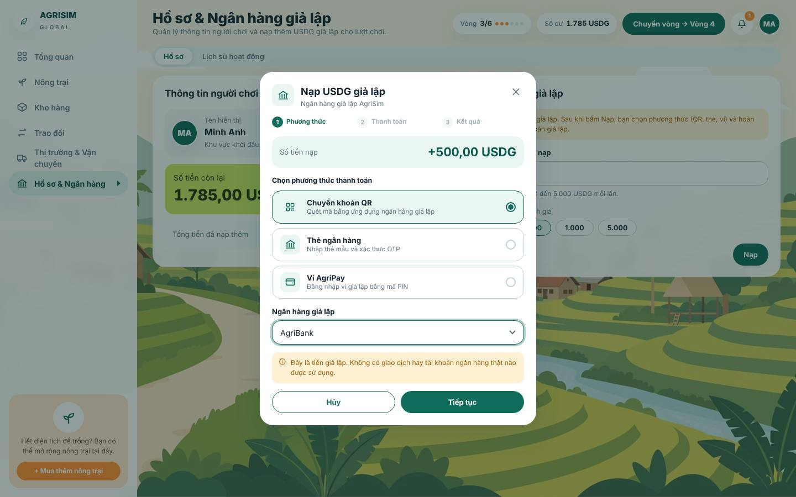
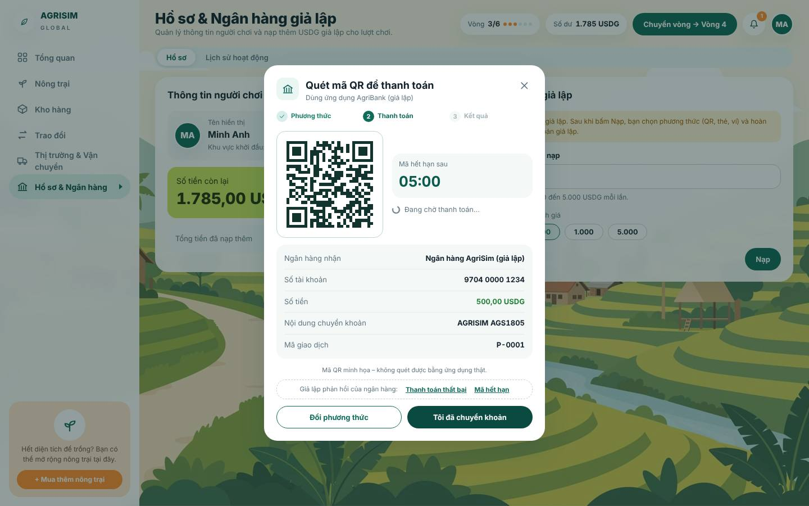
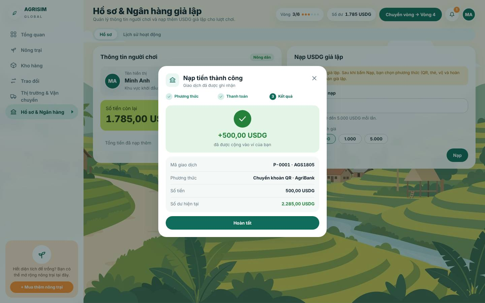
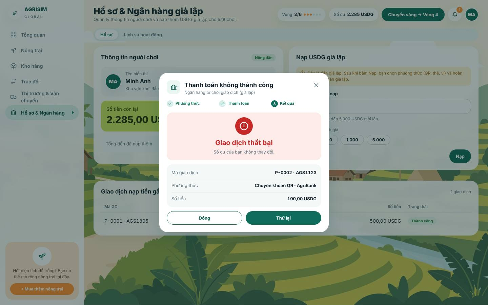
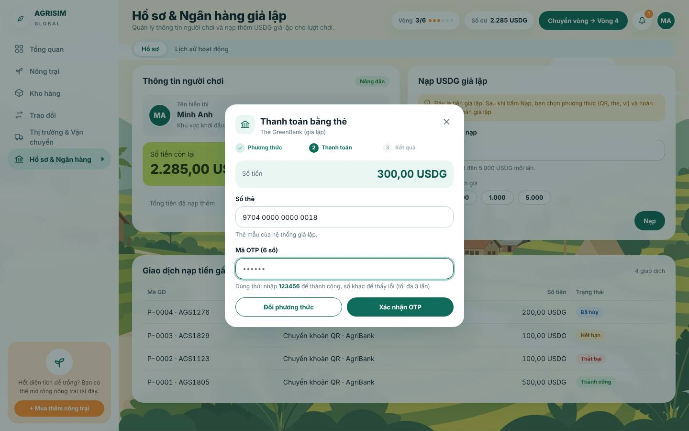
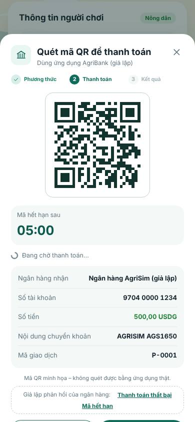

# Quy trình nạp tiền qua ngân hàng giả lập (mở rộng nghiệp vụ)

Điểm vào: **Hồ sơ → Nạp USDG** hoặc **Nông trại → Mua thêm → thiếu tiền → Nạp USDG** (BPMN-F4).
Toàn bộ là tiền giả lập; không có kết nối ngân hàng thật.

## 1. Luồng chính
| Bước | Người chơi | Hệ thống |
|---|---|---|
| 0 | Nhập số tiền (100–5.000, bội số 100) hoặc chọn nhanh mệnh giá | Kiểm tra số tiền; sai thì báo lỗi, **không** mở cổng |
| 1 | Chọn phương thức: **QR** / **Thẻ ngân hàng** / **Ví AgriPay**; QR và Thẻ chọn thêm ngân hàng | Tạo đơn nạp `P-xxxx` trạng thái **Đang chờ**, sinh mã GD `AGSxxxx`, hạn 5 phút |
| 2a | **QR:** xem mã QR, số tài khoản, nội dung chuyển khoản, đếm ngược; bấm "Tôi đã chuyển khoản" | Chờ ngân hàng xác nhận → chốt đơn |
| 2b | **Thẻ:** thẻ mẫu + nhập OTP 6 số | Sai OTP: báo còn N lần (tối đa 3); đúng: chốt thành công |
| 2c | **Ví:** số điện thoại ví mẫu + PIN 6 số | Tương tự thẻ |
| 3 | Xem kết quả | **Thành công:** cộng USDG, ghi nhật ký, hiện biên lai. **Thất bại / Hết hạn:** không cộng tiền, cho "Thử lại" |
| 4 | Bấm "Hoàn tất" | Làm mới số dư; nếu đi từ bước mua mảnh đất thì **tự mở lại** bước mua |

## 2. Trạng thái đơn nạp
`Đang chờ → Thành công | Thất bại | Hết hạn | Đã hủy`  (trạng thái cuối không đổi được nữa)

## 3. Quy tắc nghiệp vụ đề xuất (cần nhóm đưa vào BRD)
- **BR-P1** Chỉ cộng USDG khi đơn ở trạng thái *Thành công*; thất bại, hết hạn, hủy đều không đổi số dư.
- **BR-P2** Mỗi đơn chỉ được cộng **một lần** (bấm trùng / gửi lại không cộng thêm; hệ thống báo "đã được ghi nhận").
- **BR-P3** Mã QR hết hạn sau **5 phút**; hết hạn thì đơn chuyển *Hết hạn*, muốn nạp phải tạo đơn mới.
- **BR-P4** Đóng cửa sổ hoặc đổi phương thức khi đang chờ thì đơn cũ chuyển *Đã hủy*.
- **BR-P5** Nhập sai OTP/PIN quá **3 lần** thì đơn *Thất bại*.
- **BR-P6** Giới hạn mỗi lần nạp giữ như BR-19: 100–5.000 USDG, bội số 100.
- **BR-P7** Lượt chơi đã kết thúc thì không được nạp (chỉ xem lịch sử).
- **BR-P8** Mỗi lần nạp thành công được ghi vào nhật ký (phương thức, mã GD, ngân hàng) và vào "Tổng tiền đã nạp thêm" (tính vào lãi/lỗ so với vốn).

## 4. Chỗ cần nhóm quyết định
- Số tiền thật: hiện nạp trực tiếp bằng USDG, **chưa có tỷ giá** USDG ↔ VND.
- Thời hạn mã (5 phút), số lần thử (3), và 3 phương thức có giữ nguyên không?
- Có cần giới hạn tổng số tiền nạp trong cả lượt chơi / theo vòng không (hiện chỉ giới hạn theo từng lần)?
- Mã QR trong bản này là **hình minh họa**, không quét được bằng app thật.

## 5. Dùng thử nhanh
- OTP/PIN đúng: `123456`; số khác để xem lỗi.
- Ở bước QR có hai liên kết "Giả lập phản hồi của ngân hàng": *Thanh toán thất bại* và *Mã hết hạn*.
- Danh sách "Giao dịch nạp tiền gần đây" nằm cuối trang Hồ sơ.

## 6. Màn hình
| | |
|---|---|
|  |  |
|  |  |
|  |  |

## 7. Cách nối với backend trong bản hiện tại
- UI: `frontend/components/payment/payment.js` chỉ gọi `AgriSim.api.createPayment({amount,method,bank})`, `AgriSim.api.settlePayment(id,result,reason)` và `AgriSim.api.payments()`.
- Adapter: `frontend/services/api/apiClient.mock.js`.
  - Đơn nạp (`P-xxxx`, mã `AGSxxxx`, hạn, trạng thái) là bản ghi giả lập phía trình duyệt, lưu `localStorage` theo `agrisim.payments.<uid>` (tối đa 20 đơn). Trạng thái lượt chơi **không** lưu ở client.
  - Chỉ khi đơn chuyển sang *Thành công* mới gọi `POST /api/game/topup { amount, requestId }`; ví, `totalTopups` và lịch sử `TOPPED_UP` do backend ghi.
  - `requestId` = mã định danh cố định của đơn, nên khi lỗi mạng rồi bấm lại, backend (idempotent) chỉ cộng tiền **một lần** (BR-P2). Lỗi mạng giữ đơn ở *Đang chờ* để người chơi thử lại.
  - Tài khoản mẫu: `topup` đi qua `services/demo/demoSession.js`, không cần backend.

## 7b. Nối cổng thanh toán thật
Khi có cổng thật: tạo đơn ở server, trả về dữ liệu QR; kết quả `paid` do **webhook của cổng thanh toán** quyết định, không để client tự báo thành công.

## 8. Kiểm thử
`frontend/tests/e2e_payment.py`: 25 kiểm tra, **25 PASS** trên bản frontend mock gốc — cần chạy lại sau khi nối backend (QR thành công/thất bại/hết hạn thật, hủy khi đóng, OTP và PIN sai, đổi phương thức, chống cộng 2 lần, đi từ BPMN-F4 và quay lại mua đất, game kết thúc, mobile).
